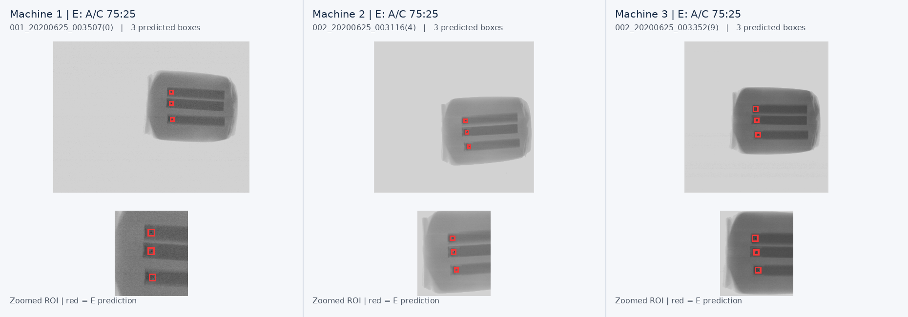
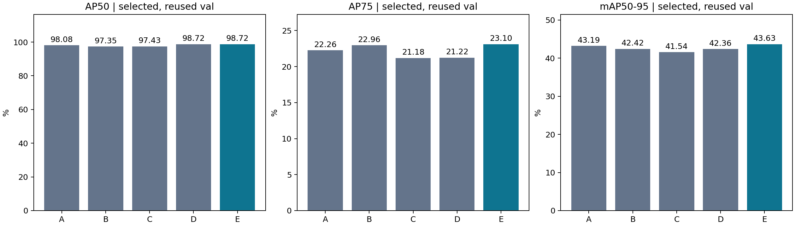
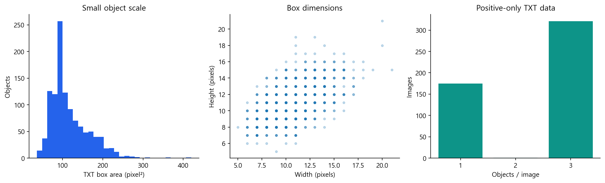
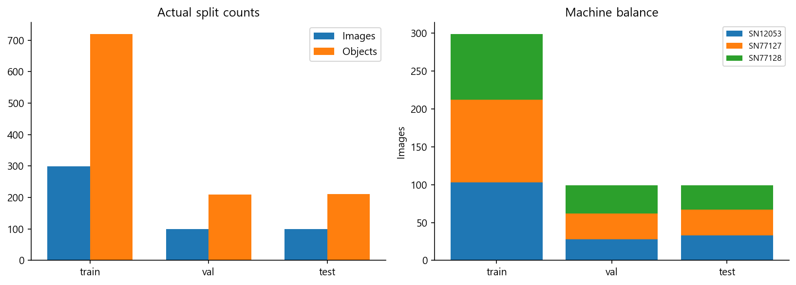
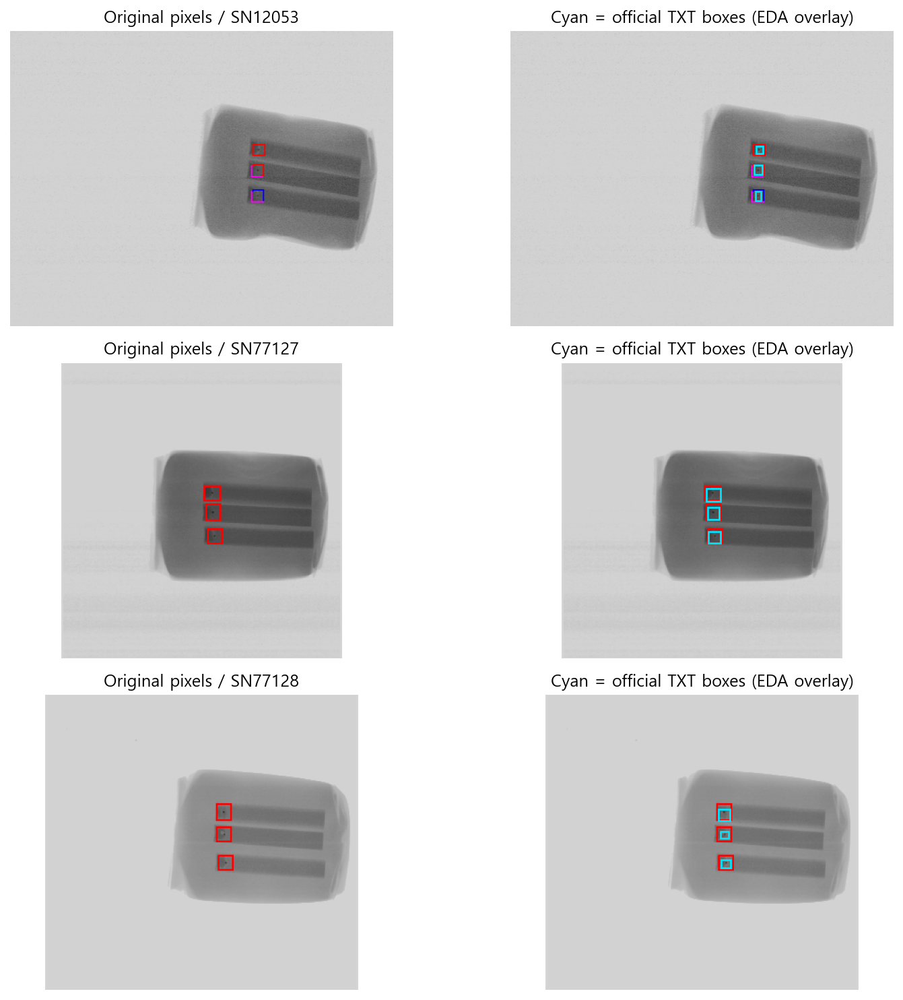
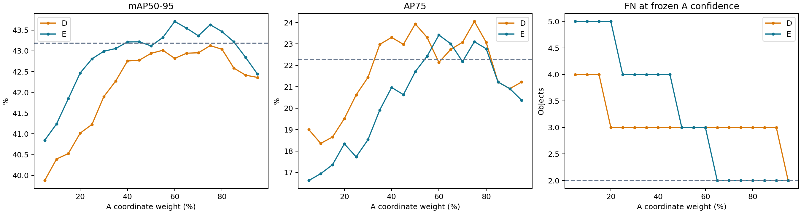

# X-Ray Foreign Object Detection

> **Conservative Bounding Box Fusion and Weight Search Using Mixed-Contrast Training for X-ray Foreign Object Detection**

제조 공정의 X-ray 영상에서 작은 이물질의 위치를 정확히 검출하기 위해, 서로 다른 대비 표현으로 학습한 **YOLO26n 검출기의 바운딩 박스 좌표를 보수적으로 융합**한 개인 프로젝트다.

기준 모델의 검출 개수와 신뢰도 점수를 유지한 상태에서 대응되는 보조 모델의 박스 좌표만 보정하였다. 두 모델 조합의 **38개 가중치 설정**을 비교하고, 검출 성능 보전 조건을 만족하는 **A:C = 75:25**를 최종 모델로 선정하였다.

<p align="center">
  
</p>

<p align="center"><sub>최종 모델 E의 이물질 검출 예시 · 빨간 박스는 예측 결과이며, 전체 검증 지표는 아래 표를 참고</sub></p>

## Key Results

검증 영상 **99장 / 정답 이물질 209개**에서 기존 원본 영상 기반 YOLO26n(A)과 최종 융합 모델(E)을 비교하였다.

| Metric | Baseline A | Final E (A:C = 75:25) | Change |
|---|---:|---:|---:|
| AP75 | 22.26% | **23.10%** | **+0.84%p** |
| mAP50-95 | 43.19% | **43.63%** | **+0.44%p** |
| True Positives | 207 | **207** | 유지 |
| False Negatives | 2 | **2** | 유지 |
| False Positives | 2 | **2** | 유지 |

AP75와 mAP50-95는 객체 탐지의 위치 정밀도를 비교하기 위한 지표다. TP/FN/FP는 고정된 신뢰도 임계값 **0.272(실제 설정값 0.271832734)**와 IoU 0.5 기준으로 계산하였다. 위 수치는 검증 데이터의 결과다.

<p align="center">
  
</p>

---

## 1. Project Overview

X-ray 검사는 제품 내부를 파손하지 않고 관찰할 수 있지만, 이물질의 크기가 작거나 주변 구조와의 대비가 낮으면 바운딩 박스의 위치를 정확히 추정하기 어렵다. CLAHE 같은 영상 대비 향상 기법도 항상 탐지 정확도를 높이지는 않는다.

이 프로젝트는 KAMP 제조데이터 경진대회를 준비하는 과정에서 X-ray 데이터를 활용해 **개인적으로 진행**하였다. 하나의 전처리 방식만 선택하기보다, **원본 영상과 대비가 보강된 영상에서 얻은 검출 위치 정보를 함께 활용**하였다. 기준 YOLO26n의 판단을 유지하면서 일대일로 대응되는 보조 모델의 박스만 조정하는 방식을 설계하였다.

핵심 구현은 다음과 같다.

- X-ray 영상에 포함된 색상 표시를 제거하고 원본·CLAHE 학습 입력을 구성
- 원본(A), CLAHE(B), 원본/CLAHE 혼합 학습(C)의 YOLO26n 비교
- A+B(D), A+C(E)의 **일대일 박스 대응 및 가중 좌표 융합**
- 5% 간격의 **총 38개 융합 설정**을 동일 검증셋에서 비교
- TP·FP와 조건별 TP 보전 기준을 적용해 최종 **75:25 융합 비율** 선정

## 2. Dataset & Preprocessing

데이터는 [KAMP X-Ray 제조 데이터셋](https://www.kamp-ai.kr/aidataDetail?AI_SEARCH=X-Ray&page=1&DATASET_SEQ=12&DISPLAY_MODE_SEL=CARD&EQUIP_SEL=&GUBUN_SEL=&FILE_TYPE_SEL=&WDATE_SEL=)에서 확보하였다.

| Item | Description |
|---|---|
| Source | KAMP X-Ray dataset |
| Images | 497장 |
| Task | Single-class foreign object detection |
| Annotations | TXT 기반 Bounding Box |
| Train / Validation / Test | **299 / 99 / 99장** |
| Validation objects | **209개** |
| Image input | 색상 표시 제거 후 grayscale 기반 3채널 또는 CLAHE 입력 |

촬영일과 중복 영상 그룹을 고려하여 데이터를 분리하였다. 저장소에는 원본 영상과 가공 데이터셋을 포함하지 않았으며, **고정된 분할 정보와 전처리 재현 코드**만 보관하였다. Test 99장은 별도로 구분되어 있지만, 아래 논문 기반 성능 비교에서는 사용하지 않았다.

<p align="center">
  
</p>

<p align="center"><sub>정답 박스의 크기 분포 · 작은 이물질을 포함한 데이터 특성</sub></p>

<p align="center">
  
</p>

<p align="center"><sub>학습·검증·시험 데이터의 영상 및 객체 수와 설비별 분포</sub></p>

### 2.1 Annotation marker removal

원본 X-ray 영상에는 이물질의 위치를 나타내는 색상 표시가 포함되어 있다. 해당 표시를 모델이 정답 단서로 학습하지 않도록 다음 순서로 제거하였다.

1. RGB 채널 간 차이로 색상 표시 영역을 검출
2. 마스크를 확장해 표시 테두리까지 포함
3. OpenCV **Telea inpainting**으로 표시 영역을 복원
4. 정리된 영상을 모든 모델의 공통 입력으로 사용

이 전처리에는 TXT 정답 박스나 예측 결과를 입력하지 않는다.

<p align="center">
  
</p>

<p align="center"><sub>KAMP 원본 영상의 색상 표시와 TXT 정답 박스 시각화</sub></p>

### 2.2 CLAHE & mixed-contrast training

대비 표현의 차이를 확인하기 위해 CLAHE를 적용하였다.

| Parameter | Value |
|---|---:|
| CLAHE clip limit | 2.0 |
| CLAHE tile grid | 8 × 8 |
| YOLO input size | 640 × 640 |
| Base model | YOLO26n |

혼합 학습(C)에서는 학습 샘플을 읽을 때마다 **원본과 CLAHE 영상을 각각 50% 확률로 선택**하였다. 데이터를 두 배로 복제한 것이 아니라 같은 학습 샘플에 서로 다른 대비 표현을 적용한 방식이다.

## 3. Model Design

### 3.1 Single models & fusion models

| Model | Training / Composition | Inference input |
|---|---|---|
| **A** | 표시를 제거한 원본 영상으로 YOLO26n 학습 | Original |
| **B** | CLAHE 영상으로 YOLO26n 학습 | CLAHE |
| **C** | Original/CLAHE를 50:50 확률로 혼합 학습 | CLAHE |
| **D** | A와 B의 대응 박스 좌표 융합 | A + B |
| **E** | A와 C의 대응 박스 좌표 융합 | A + C |

최종 모델 **E**는 새 검출기를 추가 학습한 것이 아니라, 기존 A와 C의 추론 결과를 결합하는 방식이다.

### 3.2 Conservative Bounding Box Fusion

일반적인 박스 융합과 달리 기준 모델 A의 검출 박스와 보조 모델의 박스를 일대일로 연결하고, 아래 조건을 만족할 때만 좌표를 결합하였다.

- 두 박스의 IoU **0.5 이상**
- 기준 박스 대비 보조 박스의 가로·세로 크기 비율 **0.67–1.5**
- 박스 크기로 정규화한 중심 이동 비율 **0.3 이하**
- 후보가 여러 개면 IoU가 가장 높은 박스를 선택하며, 보조 박스의 중복 대응을 허용하지 않음

대응 조건을 만족하지 않으면 A의 박스 좌표를 그대로 사용한다. 또한 **A의 검출 박스 개수·순서·신뢰도 점수는 변경하지 않는다.**

융합식은 다음과 같다.

\[
B_{f}=\alpha B_{A}+(1-\alpha)B_{P}
\]

- \(B_A\): 기준 모델 A의 바운딩 박스 좌표
- \(B_P\): 보조 모델 B 또는 C의 대응 박스 좌표
- \(\alpha\): 기준 모델 A의 좌표 가중치

최종 E에서 \(\alpha=0.75\)이므로 **A 좌표 75% + C 좌표 25%**로 계산한다. 가중치는 *박스 좌표*에 적용하며 신뢰도를 평균하지 않는다.

```text
X-ray image
     |
Color-marker removal
     |
     +-----------------------+
     |                       |
Original input          CLAHE input
     |                       |
YOLO26n A              YOLO26n C
(original training)   (mixed-contrast training)
     |                       |
     +---- One-to-one box matching
                    |
        IoU / size / center constraints
                    |
      Weighted coordinate fusion
               A 75% + C 25%
                    |
   Final boxes with A count & confidence
```

## 4. Fusion Weight Search

두 가지 모델 조합에서 기준 모델 A의 좌표 가중치를 **5%부터 95%까지 5% 간격**으로 변경하였다.

- D = A+B: 19개 설정
- E = A+C: 19개 설정
- **총 38개 설정**, 추가 모델 학습 없이 기존 검출 결과 비교

후보 선정에서는 기준 A 대비 **TP가 감소하지 않고 FP가 증가하지 않는 조건**을 우선 적용했다. 소형 객체 및 저대비 객체 등을 포함한 조건별 TP도 감소하지 않도록 제한하였다. 해당 조건을 만족하는 후보 중 mAP50-95가 가장 높은 설정을 선택하고, AP75와 AP50을 다음 비교 기준으로 사용하였다.

<p align="center">
  
</p>

| Candidate | mAP50-95 | FN | FP | Preservation constraints |
|---|---:|---:|---:|---|
| D (A:B = 75:25) | 43.13% | 3 | 3 | Fail |
| D (A:B = 95:5) | 42.36% | 2 | 2 | Pass |
| E (A:C = 60:40) | **43.71%** | 3 | 3 | Fail |
| **E (A:C = 75:25)** | **43.63%** | **2** | **2** | **Pass — Final** |

E의 60:40은 mAP50-95가 가장 높았으나 FN·FP가 각각 3개로 증가하였다. 75:25는 mAP50-95 **43.63%**를 기록하면서 기존 A의 FN·FP **2개씩**을 유지하여 최종 설정으로 채택하였다.

## 5. Experimental Results

### 5.1 Model comparison

동일한 검증셋 99장, 정답 이물질 209개에서 다섯 모델을 비교하였다.

| Model | AP75 (%) | mAP50-95 (%) | TP | FN | FP |
|---|---:|---:|---:|---:|---:|
| A (Original) | 22.26 | 43.19 | 207 | 2 | 2 |
| B (CLAHE) | 22.96 | 42.42 | 203 | 6 | 6 |
| C (Mixed contrast) | 21.18 | 41.54 | 202 | 7 | 5 |
| D (A:B = 95:5) | 21.22 | 42.36 | 207 | 2 | 2 |
| **E (A:C = 75:25)** | **23.10** | **43.63** | **207** | **2** | **2** |

B와 C의 단독 mAP50-95는 A보다 낮았지만, 혼합 학습 C를 A와 결합한 E는 위치 정밀도 지표를 개선하였다. AP75는 A 대비 **0.84%p**, mAP50-95는 **0.44%p** 상승하였다.

### 5.2 Detection visualization

README 상단에는 서로 다른 설비에서 수집된 X-ray 영상에 최종 E의 예측 박스를 표시한 사례를 제시하였다. 예시 하단에는 이물질이 포함된 영역을 확대하였다. 해당 이미지는 일부 영상의 시각화이며, 전체 검증 결과는 위의 평가표를 기준으로 해석한다.

## 6. Repository Structure

```text
XRay_Foreign_Object_Detection/
├── Predict.py                   # 단일 이미지 검출 실행
├── Train_run.py                 # A/B/C 선택적 재학습
├── V6_run.py                    # 38개 융합 비율 검증 실험
├── prepare_data.py              # KAMP 원본에서 학습 데이터 재구성
├── configs/                     # 학습·융합·판정 기준 설정
├── models/
│   ├── A/selected.pt            # 원본 기반 YOLO26n
│   ├── B/selected.pt            # CLAHE 기반 YOLO26n
│   ├── C/selected.pt            # 혼합 학습 YOLO26n
│   └── pretrained/yolo26n.pt    # 사전학습 가중치
├── src/                         # 전처리·검출·융합·평가·학습 코드
├── results/
│   ├── EDA/                     # 데이터 메타데이터·대표 시각화
│   ├── comparison.png           # 모델 성능 비교
│   ├── weight_sweep.png         # 융합 가중치 탐색 결과
│   ├── final_detection_examples.png
│   ├── protocol.json            # 실험 설정·모델 검증 정보
│   └── selection_lock.json      # 최종 가중치 선정 정보
└── requirements.txt
```

`Data/` 폴더는 저장소에 포함하지 않았다. 원본 데이터셋을 별도로 다운로드한 후 전처리 스크립트로 생성한다. D/E는 별도 가중치 파일을 갖는 모델이 아니라 A/B/C의 추론 결과를 조합하는 모델이다.

## 7. How to Run

### 7.1 Clone & install

```bash
git clone https://github.com/raccoon297/XRay_Foreign_Object_Detection.git
cd XRay_Foreign_Object_Detection
```

Python 환경을 준비하고 사용 중인 CPU/CUDA 환경에 맞는 `torch`와 `torchvision`을 먼저 설치한다. 이후:

```bash
pip install -r requirements.txt
```

프로젝트 설정은 `ultralytics==8.4.171` 버전을 사용한다.

### 7.2 Rebuild the dataset

[KAMP X-Ray 데이터셋 페이지](https://www.kamp-ai.kr/aidataDetail?AI_SEARCH=X-Ray&page=1&DATASET_SEQ=12&DISPLAY_MODE_SEL=CARD&EQUIP_SEL=&GUBUN_SEL=&FILE_TYPE_SEL=&WDATE_SEL=)에서 원본 BMP/TXT 파일을 다운로드하고 압축 해제한다.

```bash
python prepare_data.py --source "../KAMP_XRay_Extracted"
```

`--source`에는 실제 원본 BMP/TXT 파일을 포함한 압축 해제 폴더를 지정한다. 스크립트는 보존된 manifest의 파일명과 SHA-256을 대조하고, 총 **497개 영상(299/99/99)**에 대해 표시 제거 및 CLAHE 입력을 재구성한다. 다른 버전의 데이터나 누락된 파일은 일치하지 않을 수 있다.

### 7.3 Single-image inference

다운로드한 BMP 등 X-ray 이미지 한 장을 최종 모델 E로 추론한다.

```bash
python Predict.py --image "path/to/image.bmp" --model E
```

이미 색상 표시 제거를 완료한 이미지를 입력할 때는 `--marker-removed` 옵션을 추가한다.

```bash
python Predict.py --image "Data/val/images/sample.png" --model E --marker-removed
```

이미지 경로는 실제 파일명으로 변경한다. 예측 결과는 기본적으로 `results/user_predictions/`에 JSON과 PNG로 저장되며, 같은 이름의 출력 파일이 있으면 덮어쓰지 않는다. 단일 이미지 추론은 CPU에서도 실행할 수 있다.

### 7.4 Evaluation / weight sweep

```bash
python V6_run.py --check
python V6_run.py --stage all
```

평가 스크립트는 **CUDA GPU**를 요구한다. 첫 번째 명령은 실행 환경을 점검하고, 두 번째 명령은 A/B/C 검증 및 D/E의 융합 설정 **38개**를 재평가하여 결과를 생성한다. 재평가 과정의 이미지·JSON·CSV는 실행 후 `results/` 아래에 별도로 생성되며, 이 저장소에는 주요 결과 그림과 설정만 보존했다.

### 7.5 Optional retraining

```bash
python Train_run.py --model A --run-name A_retrain
python Train_run.py --model B --run-name B_retrain
python Train_run.py --model C --run-name C_retrain
```

재학습은 각 모델의 별도 출력 폴더에 저장하며, 저장된 대표 가중치(`models/A`, `models/B`, `models/C`)를 덮어쓰지 않는다. 학습에도 CUDA GPU가 필요하다.

## 8. Evaluation Scope

- **검증셋 기준 성과:** 38개 융합 설정과 최종 가중치는 동일한 Validation 99장에서 선정하였다. 저장된 99장 Test split은 본 결과의 독립 성능 검증에 사용하지 않았다.
- **검출 개수·신뢰도 보존:** 융합 과정에서 A의 예측 개수와 신뢰도는 유지한다. TP/FN/FP가 동일하다는 결과는 선택한 E(75:25)의 검증 성능을 뜻한다.
- **양성 영상 평가:** 데이터는 이물질이 표시된 X-ray 영상으로 구성되어 있으며, 여기서 FP는 정답과 대응되지 않은 검출 박스를 의미한다. 정상 제품만으로 구성된 별도 데이터에서의 오경보율은 평가하지 않았다.
- **연산량:** E는 A와 C 두 모델의 추론이 필요하므로 단일 A보다 연산 비용이 증가한다.

## 9. References

- **Project manuscript:** *X-ray 이물질 검출을 위한 대비 혼합 학습 기반 보수적 박스 융합 및 가중치 탐색* (개인 연구 원고).
- **Dataset:** [KAMP X-Ray 제조 데이터셋](https://www.kamp-ai.kr/aidataDetail?AI_SEARCH=X-Ray&page=1&DATASET_SEQ=12&DISPLAY_MODE_SEL=CARD&EQUIP_SEL=&GUBUN_SEL=&FILE_TYPE_SEL=&WDATE_SEL=).
- A. Telea, “An Image Inpainting Technique Based on the Fast Marching Method,” *Journal of Graphics Tools*, 2004.
- K. Zuiderveld, “Contrast Limited Adaptive Histogram Equalization,” *Graphics Gems IV*, 1994.
- R. Solovyev, W. Wang, and T. Gabruseva, “Weighted boxes fusion: Ensembling boxes from different object detection models,” *Image and Vision Computing*, 2021.
